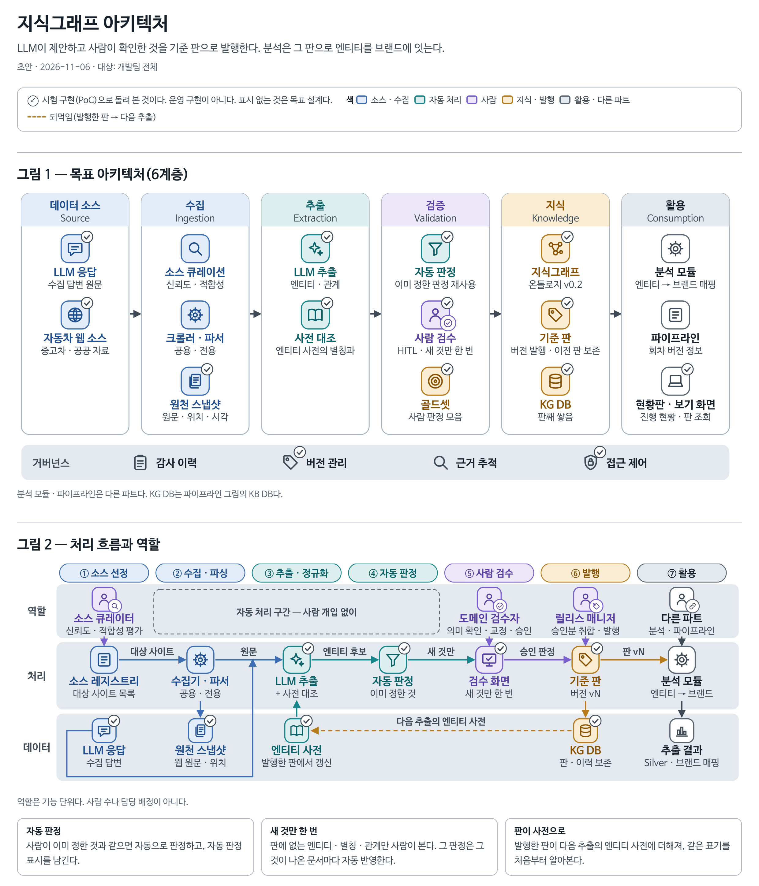

# knowledge-graph

지식그래프(KG) 이해를 위한 문서. 담당: 양승용, 강희준

## 대전제

**SSOT로 관리하는 모든 문서는 내용을 명확하게 전달할 수 있는 수준에서 가장 짧고 간결하게 정리된 문서로 가공해 넣는다.**

## 여기에 두는 것

- 아키텍처: 목표 아키텍처(6계층), 처리 흐름과 역할, 받는 것 · 주는 것, 다른 파트와 정할 것: [kg-architecture.md](kg-architecture.md)
- KG의 설계 · 결정 · PoC 기록은 지식그래프 저장소에 둔다([shared/urls.md](../shared/urls.md)).

다른 파트도 읽어야 하는 내용은 `shared/`에 둔다.

## 아키텍처

원본: [kg-architecture.html](kg-architecture.html)
