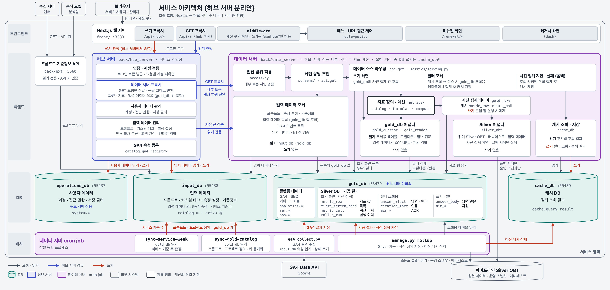

# service

서비스(BFF) 이해를 위한 문서. 담당: 김태호

## 대전제

**SSOT로 관리하는 모든 문서는 내용을 명확하게 전달할 수 있는 수준에서 가장 짧고 간결하게 정리된 문서로 가공해 넣는다.**

## 여기에 두는 것

- 지표 정의: 분모 조건, 자사 여부 판정, 대표 답변 선정, 집계 기간(회차·기간), 계산식: [metric-definitions.md](metric-definitions.md)
- 사전 집계(Gold): 대상 지표, 갱신 방식
- 조회 시점 집계와 캐시: [cache-db.md](cache-db.md)
- 화면 조립, 지표 API
- 프롬프트·기준정보 API: [prompt-reference-api.md](prompt-reference-api.md)
- GA4(AI 유입 전환): 추후 논의

다른 파트도 읽어야 하는 내용은 `shared/`에 둔다.

## 아키텍처

허브 서버 분리 뒤의 목표 구조다.

원본: [service-architecture.html](service-architecture.html)
